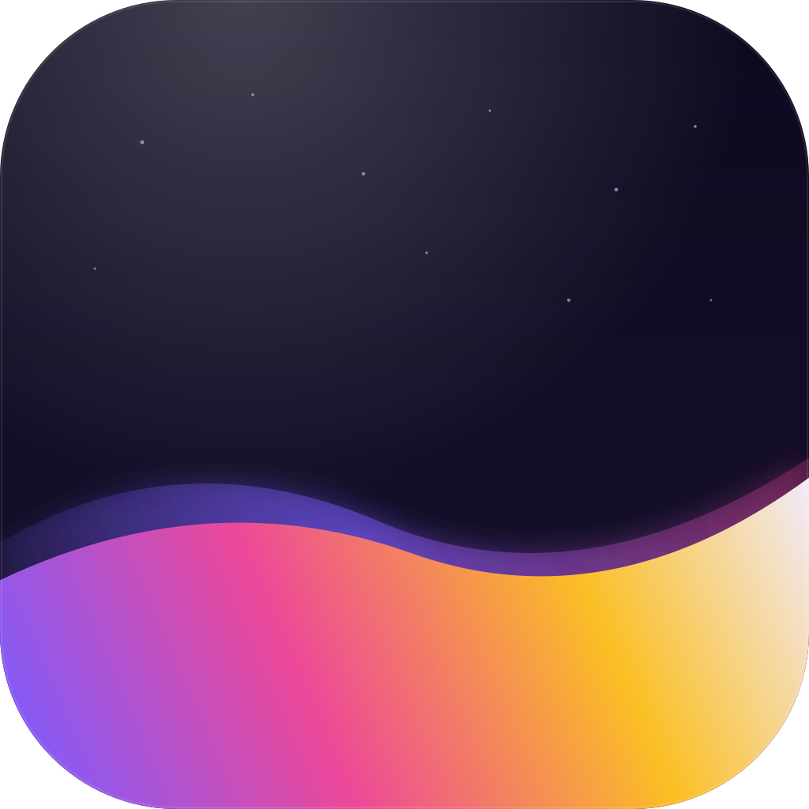
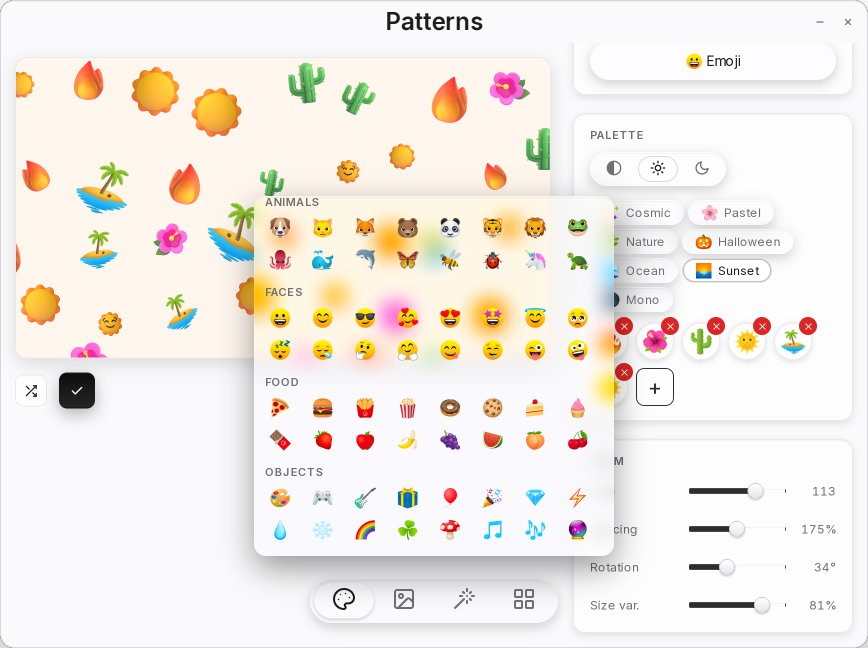
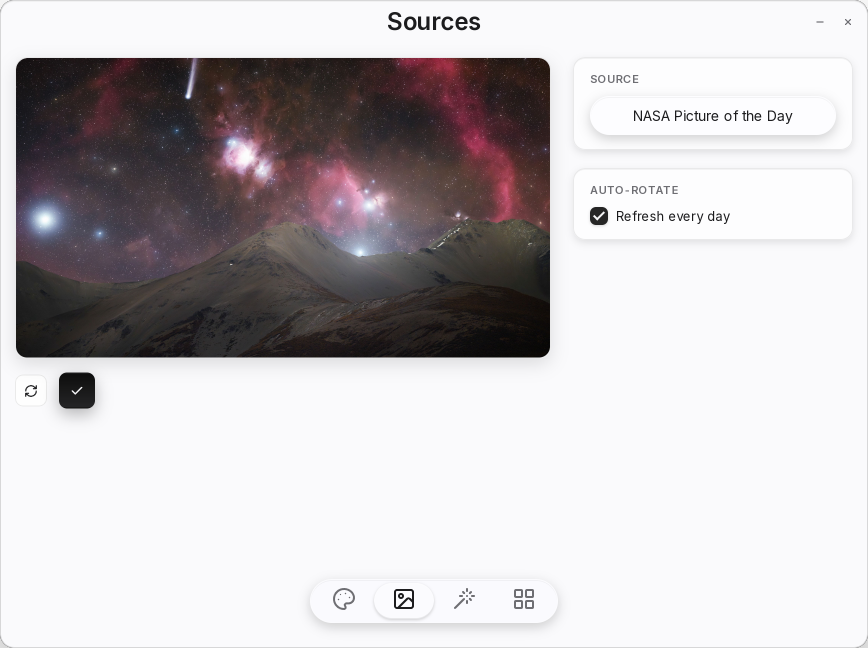
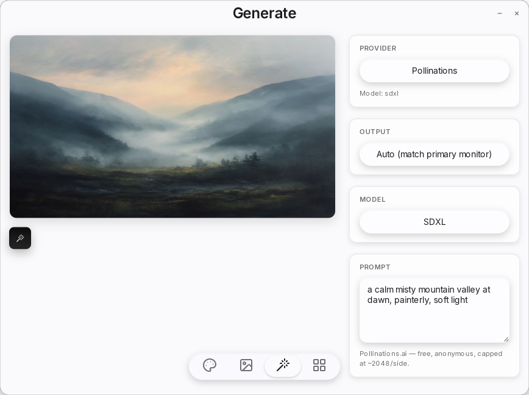
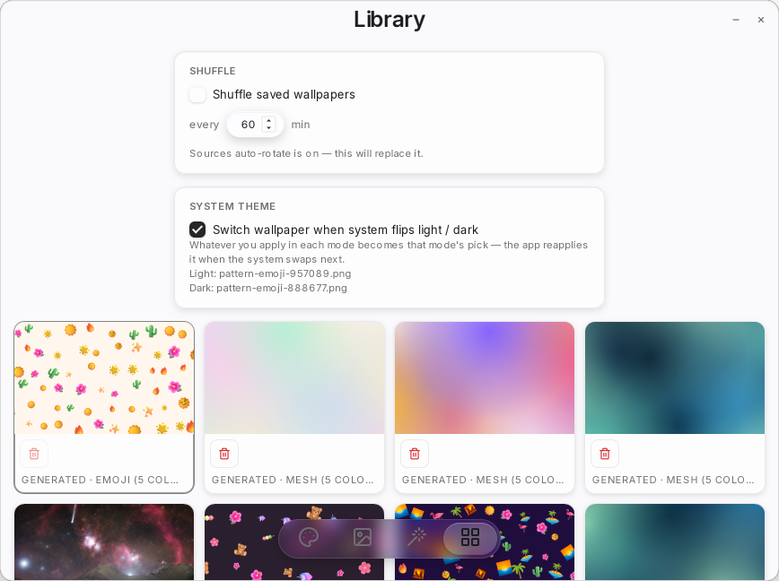

<div align="center">



# Ambient

**Wallpapers that move with you.**

A native wallpaper studio for macOS, Windows and Linux. Generate animated patterns, pull a fresh photo every day, or describe a scene and let an AI paint it. Then put a clock, the weather or a countdown on top of it.

[](https://github.com/atayoez/ambient/releases/latest)
[](https://github.com/atayoez/ambient/actions/workflows/build.yml)


[](LICENSE)
[](https://paypal.me/atayozc)



</div>

## Features

| | |
|---|---|
| **Twelve pattern generators** | Mesh gradients, dots, stripes, geometric shapes, flowing lines, waves, aurora, bokeh, petals, emoji walls, Matrix rain with your own text, and a CRT test card. Tweak the knobs or shuffle until one clicks. |
| **Live wallpapers** | Patterns animate as a real GPU-rendered desktop layer, and videos and GIFs play too. Works on KDE Plasma, GNOME, COSMIC and other Wayland desktops, Windows and macOS, on every monitor. |
| **Curated photo sources** | A fresh photo daily from NASA and Bing, random shots from Lorem Picsum, all free with no key. Add a free Unsplash, Pexels or Wallhaven key to search. |
| **AI generation** | Type a prompt, hit ⌘↩. Pollinations works for free with no setup; bring your own OpenAI key for DALL·E 3. |
| **Widgets** | A live clock, weather with a three-day forecast, a calendar, a countdown and a note, drawn over the wallpaper on every desktop. Glass or plain style, anchored wherever you like. |
| **Your own library** | Everything you apply is saved locally. Shuffle it on a timer, or keep one wallpaper for light mode and another for dark. |
| **Stays on your machine** | No account, no telemetry, no backend. The only network calls go to the photo or AI providers you turn on. |

<div align="center">
<table>
<tr>
<td></td>
<td></td>
</tr>
<tr>
<td align="center"><sub>Sources</sub></td>
<td align="center"><sub>Generate</sub></td>
</tr>
<tr>
<td></td>
<td></td>
</tr>
<tr>
<td align="center"><sub>Library</sub></td>
<td align="center"><sub>Patterns</sub></td>
</tr>
</table>
</div>

## Install

Grab the file for your OS from the [latest release](https://github.com/atayoez/ambient/releases/latest):

| Platform              | File                                        | Notes                                                                 |
|-----------------------|---------------------------------------------|-----------------------------------------------------------------------|
| macOS (Apple Silicon) | `Ambient-x.y.z-macOS-aarch64.dmg`           | Open the DMG, drag Ambient to Applications. Unsigned: right-click → Open the first time. |
| macOS (Intel)         | `Ambient-x.y.z-macOS-x86_64.dmg`            | Same as above, for 2020-and-earlier Intel Macs.                       |
| Windows x86_64        | `Ambient-x.y.z-Windows-x86_64-setup.exe`    | NSIS installer. Unsigned: "More info → Run anyway" the first time.    |
| Windows ARM64         | `Ambient-x.y.z-Windows-aarch64-setup.exe`   | Native ARM64 build for Snapdragon / Copilot+ PCs.                     |
| Linux x86_64          | `Ambient-x.y.z-Linux-x86_64.AppImage`       | `chmod +x` and run. Needs `webkit2gtk-4.1` on the host.               |
| Linux aarch64         | `Ambient-x.y.z-Linux-aarch64.AppImage`      | For Raspberry Pi 4/5, Asahi-on-Apple-Silicon, ARM workstations.       |

### Linux requirements

The AppImage bundles its own GUI deps, but it expects `webkit2gtk-4.1` on the host. On Arch:

```bash
sudo pacman -S --needed webkit2gtk-4.1
```

On Ubuntu 22.04+ / Fedora the equivalent package is available in the default repos as `libwebkit2gtk-4.1-0`.

Live wallpapers on GNOME use a small GNOME Shell extension that Ambient installs the first time you apply one. GNOME only loads new extensions at login, so that first time asks you to log out and back in once.

## Keyboard shortcuts

| Shortcut             | Action                                       |
|----------------------|----------------------------------------------|
| `⌘1` … `⌘6`          | Jump to tab 1–6                              |
| `⌘Enter`             | Primary action (Apply / Generate / Re-fetch) |
| `⌘⇧R`                | Re-roll (Patterns) / Re-fetch (Sources)      |

`⌘` is Cmd on macOS, Ctrl on Windows/Linux.

## Build from source

Requires Rust (stable), [Bun](https://bun.sh) ≥ 1.4, and the platform-specific Tauri prerequisites listed on [tauri.app](https://tauri.app/start/prerequisites/).

```bash
git clone https://github.com/atayoez/ambient
cd ambient
bun install
bun run tauri dev          # hot-reload dev build
bun run tauri build        # production installers for your platform
```

The release bundle ends up under `src-tauri/target/release/bundle/`.

On Linux the shell also links `gtk-layer-shell` (the Wayland live-wallpaper surface), so a dev host needs its headers too: `gtk-layer-shell-devel` on openSUSE, `libgtk-layer-shell-dev` on Debian/Ubuntu.

See [`docs/DEVELOPMENT.md`](docs/DEVELOPMENT.md) for the full dev / test / release commands (including the linuxdeploy bundling-step fallback and `jq` snippets for resetting library state during testing).

## Project structure

```
src/              React + TypeScript frontend
  components/     Tab components + shared layout primitives
  lib/            Pattern engine, sources, store, app-level hooks
design-system/    Color + type tokens, reference HTML
src-tauri/
  src/
    lib.rs        Tauri builder + plugin registration + tray
    desktop.rs    set_wallpaper (cross-platform + COSMIC override)
    monitor.rs    randr-shelling monitor detection
    library.rs    File mgmt commands + WebP thumbnail cache
    live_win.rs   Live wallpaper window: Windows (WorkerW)
    live_mac.rs   Live wallpaper window: macOS (desktop window level)
    live_linux.rs Live wallpaper window: Linux Wayland layer-shell (COSMIC, Sway, …) and GNOME
    live_gnome.rs Installs + checks the GNOME Shell extension that places it on GNOME
  core/           ambient-core: renderer, sources, stores, KDE live plugin
plasma/           KDE Plasma wallpaper plugin (QML + baked shaders)
gnome/            GNOME Shell extension for live wallpapers (embedded in the app)
scripts/
  release.sh     Cut a versioned release: changelog + bump + tag + push
  publish.sh     Partial-aware publisher (run by CI; re-runnable locally)
website/         Source of the former marketing site (no longer deployed)
docs/            DEVELOPMENT.md + screenshots + operational notes
```

The design system tokens live in [`design-system/colors_and_type.css`](design-system/colors_and_type.css) — change anything there and the app picks it up via a single `@import` from `src/index.css`.

## Contributing

Issues and PRs welcome. Quick checks before pushing:

```bash
bun x tsc --noEmit                       # type-check
bun run lint                              # biome lint + format
bun run test                              # bun test (JS unit tests)
(cd src-tauri && cargo test --lib)        # cargo (Rust unit tests)
```

CI runs the same `check` job on every push/PR. The six-cell installer matrix ({Linux, Windows, macOS} × {x86_64, aarch64}, each built natively on a GitHub-hosted runner) and the publish job only fire on a `v*` tag push or a manual dispatch — `bun run release X.Y.Z` cuts the tag.

## Support

If Ambient earns a spot on your desktop, a coffee keeps the releases coming:

[](https://paypal.me/atayozc)

## License

Proprietary. See [`LICENSE`](LICENSE).

The Microsoft Fluent emoji art used by the Emoji pattern is MIT-licensed by Microsoft — see [Microsoft/fluentui-emoji](https://github.com/microsoft/fluentui-emoji).
